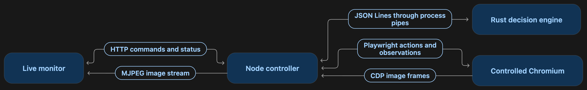

# browser-driver

A visible browser driver with a Rust application-state engine. People and agents
observe an application, choose a valid semantic command, watch it execute, and
inspect evidence of the outcome. Authored commands and recipes run without an AI
agent once the application integration is configured.

**The primary example is actual Roots work:** Journal draft retention, save and
retry behavior, session protection, and the Strains catalogue. The local workbench
shows a sourced archive of that work and connects to the real Roots driver.



**Status:** working `0.1.1-rc.1` candidate with release preparation tooling. The
Rust engine, Node runtime, generic viewer and independent example are implemented.
An isolated Roots consumer passed
real browser/API/PostgreSQL acceptance; its everyday driver has not been migrated.
Exact candidate identities and limits are in [verification](docs/verification.md).

## Open the Roots workbench

With Node 22+:

```bash
npm ci
npm run demo
```

Open the printed URL to inspect real Roots results, screenshots, failures and
corrections. Archive entries identify their original source and test level. They
remain available when no live session is running; historical screenshots are never
presented as a live browser.

To open the current committed Roots application and its original full driver in
an isolated fixture, follow [the Roots example guide](examples/roots/README.md).
That live reference includes the workflows the dedicated product must support.
The original extracted consumer covers 15 commands and one recipe on `d4008e3`.
An additional [Journal edit consumer](integrations/roots/edit/README.md) ports four
selected recipes from a separately captured, reviewed feature snapshot. The
workbench archive remains historical; current candidate results are recorded in
[verification](docs/verification.md).

The independent notebook remains an engineering conformance fixture under
`npm run demo:notebook`, after `cargo build --locked --workspace` and
`npx playwright install chromium`. It is not the product's primary example.

```bash
npm run check
npm test
npm run test:rust
npm run test:e2e
npm run test:roots-example
```

Node checks include local loopback server tests. Browser acceptance launches an
owned Chromium and example server. [Roots consumer acceptance](integrations/roots/README.md)
additionally requires Node 24+, Docker and a pinned Roots source checkout.

## Project documents

- [Product and architecture](docs/architecture.md): what the product does, the two
  streams, Rust/Node responsibilities and extension interfaces.
- [Actual Roots experience](examples/roots/README.md): live operation, the evidence
  archive and the distinction between Roots and the extracted candidate.
- [Implementation plan](docs/plan.md): ordered milestones, completion gates and
  current checklist.
- [Development and Roots integration](docs/development-workflow.md): parallel
  development, ownership, candidate promotion/rollback and requested upstream ports.
- [Release preparation](docs/releases.md): versioned bundles, installed-package CI,
  trusted verification and explicit store update/rollback without changing Roots.
- [Protocol and public API contract](docs/contracts.md): implemented v0.1
  interfaces; still pre-release, with the tested consumers recorded below.
- [Acceptance scenarios](docs/acceptance.md): the behavior the executable tests
  must prove.
- [Verification record](docs/verification.md): actual pass/fail/not-run evidence.
- [Roots customer results](integrations/roots/RESULTS.md): package consumption,
  real scenarios, cleanup and the first customer-driven model fix.

The first delivery is a local CLI and browser monitor, one Node package and one
shared Rust library. Each application owns its nested states, facts, commands,
guards, expected outcomes, selectors and fixture setup. The core owns execution
coordination, freshness checks, protocol validation, browser viewing and resource
ownership. See the architecture document for the trust boundary and limitations.

Implementation and local verification are authorized. Registry publication,
deployment and promotion into everyday Roots usage are separate lifecycle steps.
