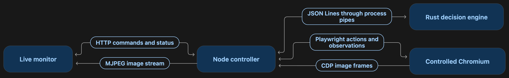
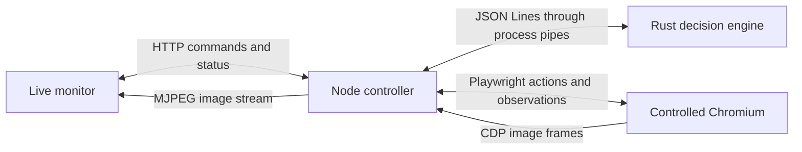
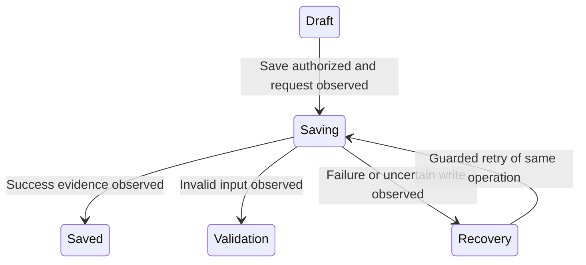

# Product and architecture

## Product purpose

Daedlo is a local workspace for supervised browser automation and QA.
The user can see the exact controlled application, understand its observed state,
choose a semantic command or authored scenario, intervene in execution and inspect
the actual outcome. Coding agents can use the same explicit public API.

The product example comes from the work actually performed in Roots. Its archive
retains the intent, commands, assertions, screenshots, failures/corrections and
source identity of those runs. The notebook exists to test independence of the
shared engine and viewer; it does not define the product's customer experience.
See [the Roots workbench](../examples/roots/README.md).

Roots is the first customer, not part of the shared product. Its React/Axum/Postgres
stack is one integration; other applications need only the components their own
behavior requires. Automatic website discovery, natural-language planning, an
authenticated cloud service and crash-resumable runs are outside the initial scope.

## Control and images travel separately

The supplied diagram is included unchanged:

An editable version of the same architecture:

JSON Lines carries small request/response messages over the native Rust process's
stdin/stdout. It is separate from CDP JPEG frames and the monitor's MJPEG stream.
The image is a mirror of the driven browser. Opening the app in another tab does
not transfer its cookies or draft. The QA engine is independent of the app's own
backend, including when that backend also happens to be Rust.

## Two kinds of state

**Driver execution state** belongs to Daedlo: idle/running/paused/stopped,
execution failure, one active run and interruption behavior. Connection health is
also observed independently. Core execution controls apply to every integration.

**Application state** belongs to the customer: nested Rust enums such as
`RootsState::Journal(JournalState::Draft)`, with contextual facts kept separately.
Customer models define how facts map to states and which commands are valid.

This is an illustrative application branch, not a fixed core enum. Performing
Save must never directly assign Saved. A completed QA command can correctly
observe a recoverable application failure. Persistence needs its own evidence.

## Deliberate extension boundaries

| Boundary | Shared responsibility | Customer responsibility |
| --- | --- | --- |
| `DriverSession` facade | Observe, execute, run recipe, pause/resume/stop, speed and close | Compose engine, adapter and environment through public APIs |
| Rust `ApplicationModel` | Protocol, decoding framework, catalog validation, fingerprints | Typed facts/state/commands/outcomes, guards, classification and verification |
| Browser adapter | Guarded action helpers and execution boundaries | Read DOM/API facts, implement semantic actions, gather read-only evidence |
| Environment/resource scope | Owned/attached handles, unwind and cleanup reporting | Start/attach/readiness and optional restart/fault capabilities |
| Versioned descriptor | Validate compatible wire contracts, render generic controls | Stable state/command IDs, hierarchy, support status and parameter definitions |
| Viewer/report | Live frames, controls, execution and outcome presentation | Safe display facts and explicit evidence references |

Initially models compile into per-application Rust engine binaries against one
shared library. One Node package contains the runtime and viewer. JSONL, motion,
image transport and utility internals remain concrete; hypothetical alternate
transports do not justify additional interfaces.

The viewer renders text/number/boolean/select parameters and state hierarchy from
descriptors. Public wire IDs are explicit, never derived from Rust Debug strings.
Declaring a planned state does not make it implemented or reachable. Unknown
facts, unsupported states and missing handlers must remain explicit failures.

## Live workspace grid

The desktop workspace gives the controlled application the largest panel, with
the state hierarchy on the left, the active authored flow on the right and
execution controls and results below. Session metadata is collapsed by default;
target/model mismatch warnings remain visible outside that disclosure. Commands,
flow steps and long results scroll within their own areas so a large catalog does
not push the application or run controls below the viewport. Narrow screens stack
these regions.

The active flow comes from the session's descriptor-owned `activeRun` identity and
observed progress, including after reload or when another client started it. Step
labels are a projection of the canonical recipe, not a second transition graph.
Finishing a step does not establish successful application persistence. Current
pending results and attributed previous results remain separate.

Disconnected status marks the image as the last captured frame and the state as
last observed. An image-stream failure is displayed independently of driver
connection status. Reconnection never replays application commands.

## One command

1. Observe the existing page/session without changing it.
2. Rust derives state, fingerprint and available commands with reasons.
3. Caller submits a command with the revision it actually reviewed.
4. Runtime reobserves and Rust checks freshness/guards before effects, including
   after pointer movement immediately before a committing action.
5. Adapter uses guarded browser primitives. Node owns the run and its progress.
6. Fresh observations and any stronger read-only evidence go to Rust verification.
7. Report execution, application outcome and effect certainty separately.

Rust evaluates each request without maintaining hidden run history. Node retains
the browser, recipe position, pending requests, speed and pause/stop state. Bounded
before/after evidence supports verification. Recipes are authored canonical plans;
automatic reach-any-state planning is not in the first API.

## Trust and lifecycle limits

Adapters are trusted integration code. Their facts must accurately represent the
application, and their effects must use the supported guarded helpers. Neither a
fingerprint nor the trait is a sandbox or an atomic browser/server lock.

Pause/stop is cooperative. An already sent request can complete after Stop; report
saved, uncertain, rejected or not-attempted according to evidence. Retrying a lost
response is safe only under the application's own idempotency/reconciliation
contract. Viewer reconnect observes the current run without replay; recovery from
a dead process is a separate feature.

Only owned resources are cleaned. Attached resources survive. New replacement
processes are registered explicitly, and partial setup/cleanup failures retain
enough ownership information to retry. No global process or container cleanup.

Session reports contain measured runtime/engine identities, customer-supplied app
metadata, bounded execution events and outcomes. They do not retain the adapter's
verification evidence. Screenshots and API/persistence evidence currently live in
separate acceptance artifacts, linked from the verification records. No telemetry
is required. Raw credentials and cookies do not belong in protocol exports, and
stable digests must not be described as anonymous data.
