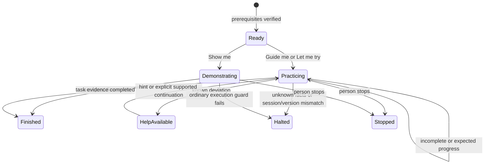

# Teaching mode: implementation plan

**Status: planned, 23 October 2026.** This document specifies a new experience;
teaching mode is not implemented or included in the current public release.
The current delivery is this plan and a clearly labeled website introduction.
Historical Roots acceptance establishes the source workflow, not learner training.

Release preflight found that the main checkout predates the live site. The owning
alpha release worktree identifies `0.1.4-alpha.3` as published and alpha.4 as a
source candidate. Its presentation mode is already released; teaching remains a
new capability. Website integration must use that release owner's current source
and preserve its immutable downloads and signed update feed.

## Product outcome

Help a person learn a real task in an application: watch an explanation, perform
the task with guidance, then attempt it independently. Reuse the application's
accepted observation model and outcome checks across QA, demonstrations and
lessons. Lesson completion must describe what was observed and how much help was
used; it must not claim employee certification or general proficiency.

The first audience is a person learning Roots' Journal. A future call-center
integration could teach a company-approved case-handling workflow, but it needs
its own model, procedure, evidence and acceptance. It is not covered by Roots.

| Experience | Person's role | Daedlo's role | Delivery order |
| --- | --- | --- | --- |
| Show me | Watch and ask for time to inspect | Run an accepted flow, explain each meaningful step, show evidence | First pilot |
| Guide me | Operate the actual application | Observe expected progress, offer hints, explain the result | First pilot |
| Let me try | Complete a task without step instructions | Check the attempted task; disclose any requested help separately | After guided practice is reliable |
| Help me now | Ask for help during everyday work | Offer approved guidance relevant to the current task | Later; production access is separate |

The first pilot is a local headed training browser beside a companion lesson
panel. The existing viewer is an image stream, not an interactive application or
an embedded tooltip layer. Anchored tooltips, browser extensions, hosted employee
accounts, LMS integration, voice coaching and course administration are deferred.
No new AI service is required for execution; agent-assisted lesson authoring is a
separate activity and never supplies authoritative completion evidence.

## First Roots lesson: keep a Journal draft while navigating

**Learning objective:** prepare an experience draft, move around Roots, and return
to the same fields while understanding that a retained draft is still unsaved.

### Source and evidence

The original Roots `draft-retained` workflow is the evidence source:

- The [archive manifest](../examples/roots/archive/manifest.json) records the
  26 September 2026 original-driver run at
  `f198c9aa4fdcb7707c4ef98b65b56dfc4ae90c0c`. Date, notes, rating and selected
  strain survived Home → Profile → Journal.
- The [27 September manual replay](../examples/roots/archive/README.md#manual-walkthrough--2026-09-27)
  used committed Roots `dd9cee67e3886333a7fe8eb7f8545d428167fb07`.
  Its [result](../examples/roots/archive/receipts/draft-retained.json) records
  11/11 steps and `draft_retained`, with the final experience still in Draft.
  The [source receipt](../examples/roots/archive/receipts/manual-walkthrough-source.json)
  identifies the frozen source and binaries.
- Read-only inspection of that pinned commit's
  `tools/qa-driver/src/recipes.rs` and
  `tools/live-qa/src/adapters/roots/assertions.mjs` confirms the sequence and
  equality check over the Journal form's inputs, selects and textareas.
- The original `QA/evidence/journal-driver-2026-09-26/results.json`, `drive.mjs`
  and `screenshots/draft-retained.png` were inspected in the Roots checkout.
  The actual UI shows Home, Smoking Journal, Profile, Log experience, Strain,
  Date, How was it?, Overall rating, Save experience and Cancel. These private
  evidence files are not copied into the public website.

The original recipe creates and saves a private strain before taking its draft
checkpoint. Its aggregate saved indicator refers to that strain, **not a saved
experience**. The lesson must never derive an experience-save claim from it.

The earlier pinned `d4008e3` example's
[`journal-draft`](../integrations/roots/engine/src/main.rs) only opens Journal
and the form; its reattachment coverage is not migration of the full original
workflow. Later Roots migration work has separate coverage and promotion records;
T0 must select and verify the exact teaching combination. New teaching acceptance
cannot be inferred from historical examples or later migration acceptance.

### Proposed reduced lesson

For a beginner, omit private-strain creation and leave Strain at **Not specified**.
This is a proposed reduced variant of the real workflow, requiring fresh acceptance.
It is not a new historical archive entry or a claim that this exact variant passed.

Prerequisites: an isolated, synthetic Roots fixture; a signed-in training account;
no existing experience draft; the pinned application's Journal is ready. Startup
must reject an existing draft rather than clear it. Authentication and fixture
setup occur before the lesson and do not count as learner achievement.

| Checkpoint | Learner-facing instruction | Required observation |
| --- | --- | --- |
| Open | Open Smoking Journal, then Log experience. | Actual experience form visible in the same session. |
| Prepare | Enter the supplied practice note under How was it? and choose a rating. Leave Strain as Not specified. | Expected synthetic notes/rating; valid date; empty strain selection. Capture an atomic private checkpoint of all four values. |
| Leave | Visit Home, then Profile. | Both distinct views observed in order in the same attempt/session. |
| Return | Open Smoking Journal again. | Experience draft form visible; date, notes, rating and strain equal the checkpoint. |
| Understand | Explain what has been kept and whether an experience was saved. | Task evidence and the learner's explicit draft-versus-save answer are recorded separately. |

Suggested completion copy: **“Your draft is still here. You have not saved an
experience.”** Use the second sentence only when the attempt's read-only effect
evidence confirms no experience write; otherwise report that saving was not
established. A click, caption, unchanged row count or form screenshot alone is not
sufficient proof of no write.

Show me may fill and navigate through guarded actions in its own demonstration
attempt. Guide me observes while the person does those actions. Separate attempts
must start from explicit fixture prerequisites; do not silently reset a demo into
practice. No lesson action saves, cancels or discards the experience. Keep the
attached browser/draft available when stopping; dispose of an owned training
fixture only through its declared lifecycle.

Let me try later uses a different synthetic note/rating and a task goal without
step instructions. Record hints as assistance. Completing this small task provides
evidence about this attempt only, not durable retention or mastery of Roots.

## Architecture and ownership

Preserve the shared [execution contract](contracts.md) and
[customer authoring boundary](../skills/browser-driver/references/model-and-flows.md).
Rust owns application interpretation and lesson checkpoint judgments; Node reads
facts, manages attempt lifecycle and renders guidance. Roots selectors, form
fields, view meanings, task criteria and fixture setup stay in the Roots
integration. The shared core never imports Roots or reads its database directly.

Add a lesson definition with a stable ID/version, objective, prerequisites,
application/model compatibility, supported modes, explanation/hint text and
references to customer-owned checkpoint evaluators. Captions and target names
are authored public metadata. Private form values and synthetic account/session
identifiers are bounded attempt data, excluded from public labels and exports.

This definition is not a second JavaScript application graph. Watch maps to
canonical Rust commands/recipes. Practice references Rust evaluations of observed
progress and before/after evidence. Lesson progression can describe instructional
order without independently deciding which application transitions are valid.

### A distinct observation path for learner actions

Presentation currently halts when a person changes its verified revision. Keep
that behavior. Practice needs an explicit read-only observation/evaluation path;
it must not call `execute()` to simulate an action that a human already performed
or disable presentation's freshness checks.

Before implementation, specify an additive capability-negotiated contract for
lesson discovery and evaluation with strict decoding, bounded inputs, request IDs,
lesson/model versions and explicit unsupported responses. Existing integrations
without the capability retain ordinary commands and presentations. The exact wire
names are a design output of milestone T1, not an implemented public API here.
Build on protocol 1's existing capability negotiation (`recipeContext:1` in the
alpha runtime). Do not invoke `recipeOnly` checkpoint/assertion commands directly
or treat canonical recipe context as evidence that a learner completed steps.

Proposed customer verdict vocabulary, separate from existing application enums:

```rust
enum LessonVerdict {
    Incomplete,
    Progress { checkpoint: CheckpointId },
    NeedsHelp { reason: PublicReason },
    Complete,
    Unknown { reason: PublicReason },
}
```

`CheckpointId` and reason mappings are customer-owned typed values. The model
receives a bounded ordered evidence window; do not add hidden cross-request Rust
history. Missing facts, a previously complete page, an unobserved navigation or
another session's result cannot establish completion.



This is a proposed lesson lifecycle, not a replacement Roots state machine.
Pausing freezes guidance/evaluation; it cannot freeze the application. On resume,
reobserve and halt if required intervening evidence is missing. Reconnect reads
status without replaying actions or assuming that missed steps occurred. Stop
ends observation and never undoes a submitted application request.

The observer does not prevent direct human clicks. Application authorization
remains responsible for permissions. A Guide me attempt dispatches no application
actions. It must acquire the same session execution exclusivity as an ordinary
run: concurrent `execute`, `runRecipe` and `startPresentation` requests are refused
while practice is active. Release the lease through the owned attempt lifecycle,
including failed startup and interrupted cleanup. A request to switch to
demonstration ends the practice attempt, records
assistance, and requires a separate start with fresh prerequisites.

Human actions also need their own bounded effect-observation window. The current
runtime reports `not_attempted` when no guarded driver effect ran, even if a person
clicked Save directly. Do not use that value as proof of no application write.
T1 must define customer-owned start/observe/end hooks for learner/external effects,
including late responses and listener cleanup, separately from the ordinary
run-scoped `beginRun`/`effectStatus` hooks. Unknown write coverage remains unknown.
TEACH-02 and TEACH-08 must exercise both the absence of a write and a real human
save without any driver primitive running.

### Evidence, privacy and accessibility

Keep four facts separate: execution lifecycle, observed application outcome,
effect evidence, and lesson result/assistance. Record attempt ID, lesson/model/app
versions, mode, verified checkpoints, hints, observation gaps, termination reason
and any explicitly requested demonstration. Prefer session-local records and an
explicit sanitized export for the first pilot; no automatic employee telemetry.
Do not reuse the runtime's latest-16-run memory buffer as a learning database.

A quiet automation log is not proof of human authorship. Isolate learner attempts
from automation, instrument relevant interactions in the controlled training
session, and require ordered observations. Describe this as observed practice,
not identity attestation. Unattributed/background changes cannot earn independent
completion. Exact provenance requirements and limitations are part of T1 review.

Use keyboard-accessible lesson controls, visible focus, readable status text,
optional hints and no forced countdown in practice. Keep the real app usable with
the companion panel. Announce meaningful progress without flooding assistive
technology. Keyboard/browser assertions do not substitute for a performed screen
reader review; record that separately when run.

## Sequenced implementation milestones

All implementation boxes remain unchecked. The user has requested the plan and
website introduction; these milestones describe future runtime work.

| ID | Owner and deliverable | Dependencies | Exit evidence |
| --- | --- | --- | --- |
| T0 | Roots integration owner: freeze the lesson application/model source and isolated synthetic fixture; replay original reference and establish the reduced variant | None | Exact source/package receipts, observed UI labels, form equality and per-attempt write evidence; live Roots untouched |
| T1 | Core + integration review: finalize lesson schema, observation/evaluation contract, provenance and lifecycle; write meaningful failing checks | T0 | Approved transition/acceptance map; genuine behavioral RED assertions, not import/setup failures |
| T2 | Core runtime + generic panel: read-only Guide me session, checkpoint/hint/stop/resume behavior, unknown-state handling | T1 | Rust contract and Node lifecycle regressions pass; no driver actions in practice; real-browser generic checks |
| T3 | Roots owner: implement the lesson evaluations and Watch mapping using shared contracts | T2 | Paired Watch/Guide real Roots acceptance on the frozen candidate; visible panel and application inspection |
| T4 | Lesson UX owner: independent attempt with varied synthetic input, explicit help accounting and sanitized result | T3 | No completion for missed steps, wrong evidence, prior demo or another session; requested help changes result classification |
| T5 | Product/QA: small novice pilot, fix observed barriers, decide release scope | T4 | Task results, assistance and authoring cost recorded; exact package and documentation gate passed before any release claim |

Keep one integration owner for dependency/lockfile/launcher changes. Core contract
and panel work can proceed in separate file ownership after T1; Roots integration
waits for the agreed interface. Do not begin a broad Roots upstream port or update
everyday dependencies as a side effect of teaching work.

## Acceptance map

Write these checks before implementing their new behavior. Record actual failing
assertions, then passing results against exact artifacts in `docs/verification.md`.

| ID | Scenario | Required result |
| --- | --- | --- |
| TEACH-01 | Watch the reduced Roots task | Accepted commands, explanations and four-field retention; no claim of learner completion |
| TEACH-02 | Learner completes Guide me | Ordered Home/Profile/Journal observations, matching fields, zero driver-dispatched effects, independently observed no experience write; concurrent commands/recipes/presentations refused |
| TEACH-03 | Correct final form already exists, or an intermediate view was missed | No independent completion; explain missing attempt evidence |
| TEACH-04 | Wrong notes/rating or known wrong navigation | Useful hint/incomplete verdict; no overwrite, auto-navigation or automatic recovery |
| TEACH-05 | Missing field, disconnected browser, changed account or incompatible lesson/model | Unknown/halted; no success or replay |
| TEACH-06 | Existing draft at startup | Refuse start without changing or discarding the draft |
| TEACH-07 | Pause, resume, stop, reconnect or delayed/duplicate result | Fresh supported evaluation only; no double advancement or inferred missed steps; attached resources survive |
| TEACH-08 | Click Save experience unexpectedly without a driver action | Learner effect window observes the write; stop the retention exercise; preserve/report actual saved or uncertain effect, including late responses; never infer no write from runtime `not_attempted` |
| TEACH-09 | Previous demo, requested hint, automation or unattributed change | Keep observed task outcome separate from assisted/independent classification |
| TEACH-10 | Close or partial cleanup fails | Clean only owned observers/resources; keep failed cleanup handles; attached app/session survives |
| TEACH-11 | Keyboard navigation, narrow screen, explicit help and progress announcements | Usable lesson controls and actual app; visible review and assistive checks reported at their true test level |
| TEACH-12 | Export and version change | No notes, credentials, raw cookies or private identifiers; refuse incompatible lessons and require deliberate revalidation |

Run affected Rust/Node checks, ordinary presentation regressions and real-browser
Roots acceptance in isolation. Keep application defects, adapter defects and
teaching defects distinct. The independent notebook can test generic contracts,
but cannot establish the Roots lesson works.

## Pilot decision and public communication

Use a small exploratory group, for example 5–10 people unfamiliar with the task.
Compare conventional instructions with guided practice where practical, then ask
for an independent variation. Track correct completion, help requested, errors,
time to finish, and lesson creation/maintenance effort. A later repeat can assess
retention. A small pilot informs usability; it does not prove broad effectiveness
or justify invented improvement percentages.

The website introduces the objective, three proposed learning experiences and this
Roots example with an adjacent **Planned** status and an explicit statement that
the download does not contain teaching mode. It may describe historical Roots
draft retention as the source, not as a completed teaching pilot. Keep the existing
recorded demo and immutable download intact. No launch date, pricing promise,
working Start lesson button or fictional training result is added.

Release readiness requires the exact runtime/integration combination to pass its
checks and the intended learner interface to be inspected. Publication, hosted
training and promotion into normal Roots use remain distinct lifecycle decisions.
