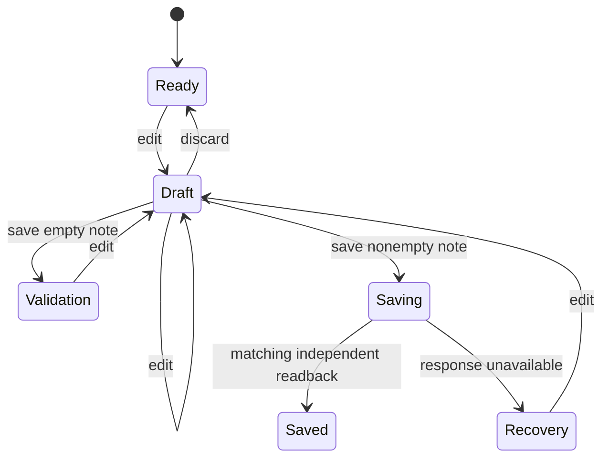

# Small model and adapter starter

This synthetic, disposable note editor is an independent conformance fixture and
a starting point for an application's integration. It is not customer acceptance
or the default Daedlo product demonstration. Adapt its facts and evidence to the
chosen application; do not copy its business rules into the shared runtime.

## Agreed slice

```rust
enum State { Editor(EditorState) }
enum EditorState { Ready, Draft, Saving, Saved, Validation, Recovery }
enum Command { Edit { text: String, category: Category }, Save, Discard }
```



Rust derives states from observed facts, authorizes commands and owns the recipe
and outcome rules. Node measures the UI, performs guarded actions and obtains
operation-scoped independent readback. An observed Saved screen alone cannot prove
a write. Recoverable transport failure does not establish whether storage changed.
The recipe refuses to overwrite an existing nonempty draft.

Acceptance covers the real Rust hello, strict Select metadata, a successful save,
empty-note validation without a write, stale draft protection, uncertain effects,
and request accounting through redirects, aborts, navigation and detached frames.
Server barriers control pending requests; tests never clear work or sleep to make
settlement pass. The browser fixture is independent of customer applications.

Implementation and measured acceptance follow below. A proposal is not a test result.

## Run from reviewed source

From the repository root, `npm run test:starter` builds a fresh model/crate pair
under ignored `artifacts/alpha4-starter/` and runs the shipped browser acceptance.
`node --test tests/starter-accounting.test.mjs` additionally checks duplicate and
late terminal callbacks with deterministic doubles; those checks do not replace
the real hello or browser run.

For a visible interactive run, build into a fresh ignored folder:

```sh
node examples/starter/build-model.mjs --output artifacts/starter-build --offline
```

Use the returned `enginePath` as `DAEDLO_STARTER_ENGINE`, choose an ignored
`DAEDLO_STARTER_OUTPUT` evidence folder, then run the selected installed `daedlo`
CLI with `--project /absolute/path/to/starter/project.mjs --report /absolute/path/to/fresh-report.json`.
Open its exact viewer URL. The CLI owns its browser/context and the project owns
its disposable fixture. Stopping the CLI cleans those owned resources. The
adapter by itself owns only listeners and preserves an attached page/context.

## Use the copied starter with an exact installed release

Copy this whole directory into the application's separate QA area. Keep the
application's normal dependencies unchanged. Verify and install the selected
runtime artifact using the selected tools' installation instructions, then run:

```sh
node /absolute/path/to/starter/build-model.mjs \
  --crate /absolute/path/to/extracted/daedlo-engine \
  --output /absolute/path/to/fresh-ignored-build
```

The builder copies the model into that output, rewrites only the shared crate path
in the copy, and creates a separate Cargo lockfile/target tree. The example pins
`daedlo-engine = 0.1.4-alpha.8`; an incompatible selected crate fails rather than
silently upgrading. Preserve the generated lockfile, build log and selected
release manifest for repeatable verification. No model lock or build output is
written back into this starter directory.

Set these absolute paths and execute the **copied** `acceptance.mjs`:

- `DAEDLO_STARTER_RUNTIME`: selected installed runtime's public `src/index.mjs`.
- `DAEDLO_STARTER_ENGINE`: builder's `enginePath`.
- `DAEDLO_STARTER_INVALID_ENGINE`: builder's `invalidEnginePath` (negative hello fixture).
- `DAEDLO_STARTER_OUTPUT`: fresh ignored evidence directory.

Playwright resolves from that installed runtime. Acceptance writes `result.json`,
separate successful/uncertain run reports, invalid-model hello evidence and viewer
screenshots. Inspect the visible screenshots; a passing headless assertion alone
does not establish presentation quality. Reusing source-runtime files does not
establish installed-release acceptance.

## Managed launch and completed reports

Use the adjacent [managed reference](../managed-starter/README.md) to adapt an
existing runner while keeping the native session intact. The tools also include
[managed integration](../../docs/managed-integration.md) and
[evidence reporting](../../docs/evidence-reporting.md) guides. Custom public-runtime
runners can use this starter's `report-archive.mjs`; native runners already have
immediate durable reporting. Both retain the report's explicit event bound.

## Request completion and ownership

`request-accounting.mjs` retains each Playwright Request object until its actual
`requestfinished` or `requestfailed` event. Context listeners handle late events
without rereading the request's now-detached frame. A duplicate/old event cannot
remove a newer request with the same URL. Only this page and its frames are in
scope; unrelated pages remain attached resources. Service-worker requests need
an application-specific contract and are blocked in this synthetic acceptance.

A zero pending count describes observed work at that boundary, not future timers
or business readiness. The adapter also waits for the application's explicit
saving phase. For long polling or streaming, define explicit application readiness
and bounded owned operations instead of excluding requests to force a pass.

Observed with Playwright 1.62.1 and its Chromium on macOS arm64: navigating away
while a response is held can leave a previous-document request without a
Playwright terminal event; the keepalive case is retained in acceptance. Detached
frame fetches can emit terminal events, which the tracker correctly handles after
detachment. Merely moving listeners to BrowserContext does not prove every
previous-document request will resolve.
The reference keeps such work unresolved, reports `requests_pending` with safe
request numbers/methods/types, and never erases it because a document disappeared
or the server finished. Acceptance verifies this honest refusal. Where the
application supports cancellation, explicitly abort and observe terminal events
**before** navigating or detaching; otherwise settle the activity first.

These are synthetic browser observations, not a reproduction of a particular
customer's adapter or evidence of a Daedlo core defect. The missing-terminal
limitation remains visible. Closing the tracker preserves its unresolved snapshot,
removes only owned listeners and rejects pending waits. It does not claim the
application requests were canceled. The resource owner closes its own browser.

The adapter resets effect evidence per run, confirms saved only after matching
operation-scoped readback, and leaves a submitted write with a lost response
uncertain. Never retry a real write without the application's deduplication or
reconciliation contract. This starter's synthetic records disappear when its
fixture server closes; they are not durable customer data.
