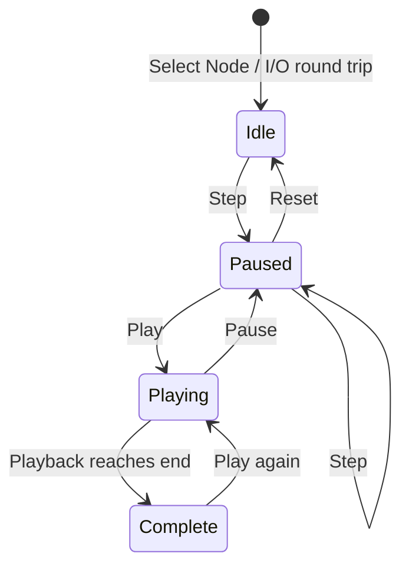

# SeeRuntime customer trial

This integration observes existing SeeRuntime playback through the public
browser-driver runtime and Rust `ApplicationModel`. It does not instrument a real
Node process or change SeeRuntime's teaching model.

The trial uses a committed source archive at
`068d573051f7e43213ba547f842624f6551706f6`. The live application checkout, its dirty
work, dependencies and services are not integration targets. The source archive
contains the bundled browser assets; no SeeRuntime install or build is needed.

## First flow

Story: a learner opens Node.js **I/O round trip**, steps to its first event, watches
playback, pauses to inspect it, advances one event and returns to the ready state.

```rust
enum Playback { Idle, Playing, Paused, Complete }
enum State { Lesson(Playback), Unavailable }
```



This describes existing committed application semantics. Completion and replay
are modeled but are not claimed as browser-tested by the first flow. Missing or
inconsistent readiness facts produce `Unavailable` and deny effects.

| Command | Required evidence |
| --- | --- |
| Select I/O lesson | Node selected, I/O selected, 11 events, Ready / event 00 |
| Step | Paused, exactly one event advanced; first event is File request |
| Play | Pause control visible and timeline advances over a bounded interval |
| Pause | Play control visible and timeline remains still over a bounded interval |
| Reset | Ready, event 00, timeline zero, no active event |

The Rust model owns state, permissions, the canonical recipe and outcome
interpretation. JavaScript reads DOM facts, issues guarded browser primitives and
collects temporal evidence. Changing timeline positions remain outside the
authorization fingerprint so a playing simulation can be paused. Model/scenario,
control readiness, loop and speed are fingerprinted. This is a local UI flow:
there are no account, database, persistence or clipboard actions.

## Evidence boundary

Use an exact verified runtime archive and matching extracted Rust crate. Build
the customer engine in a separate Cargo target and install Node packages in an
isolated consumer directory. Release-store selection does not alter the live
application's package manifests or launchers.

The [2026-10-06 result](RESULTS.md) records passing browser acceptance of this
flow against the released `0.1.1-rc.2` pair and a separate local `0.1.1-rc.3`
candidate. It also records source and integration identities and their limits.

`preservation.mjs` records an ignored private inventory of the live checkout's
tracked and nonignored untracked paths before and after the trial. It does not
copy file contents. Ignored files, external data and running services are outside
that file-inventory proof.

## Repeat the isolated trial

Use an absolute fresh `consumer` directory, an independently verified `bundle`
and its trusted `manifest_digest`. The chosen release-tools `verify` command
must pass with the actual Node/Rust environment first. Preparation does not run
the application's package manager, change its dependencies or copy live secrets.

```sh
node integrations/seeruntime/prepare.mjs "$bundle" "$consumer" "$manifest_digest"
npm --prefix "$consumer" install --ignore-scripts --no-audit --no-fund
CARGO_TARGET_DIR="$consumer/target" cargo test --manifest-path "$consumer/engine/Cargo.toml"
CARGO_TARGET_DIR="$consumer/target" cargo build --manifest-path "$consumer/engine/Cargo.toml"
```

Create a fresh `git archive` of the application pin above and extract it into an
owned `source` directory. Keep `source.tar` beside it. Run the read-only proof
against the source repository; the output must be `source-identity.json` beside
the extracted `source` directory. It compares every served `dist` file with the
pinned Git blobs, including detecting additional or missing files.

```sh
node integrations/seeruntime/source-receipt.mjs "$app_checkout" "$source" "$trial/source-identity.json"
mkdir -p "$results"
node integrations/seeruntime/run.mjs "$consumer" "$source" "$results" retain
```

The runner opens owned headless Chromium and prints a local live viewer URL.
`retain` keeps that owned session available; `close` records successful cleanup
and exits. Browser binaries must already be installed for the package's pinned
Playwright. The selected trial used the existing matching Chromium installation.
External requests are blocked, including the application's optional Google font.

The output contains exact package/model/adapter/source receipts, independent DOM
and temporal assertions, screenshots and early `owner.json` recovery handles.
Owned cleanup writes `cleanup.json`; failed cleanup retains the process and
handles for a scoped SIGTERM retry. Stop only the PID in that specific owner
receipt. A retained session has not been cleaned up. Unit checks for the customer
model are run in its isolated consumer; archive safety checks are
`node --test integrations/seeruntime/prepare.test.mjs`.
