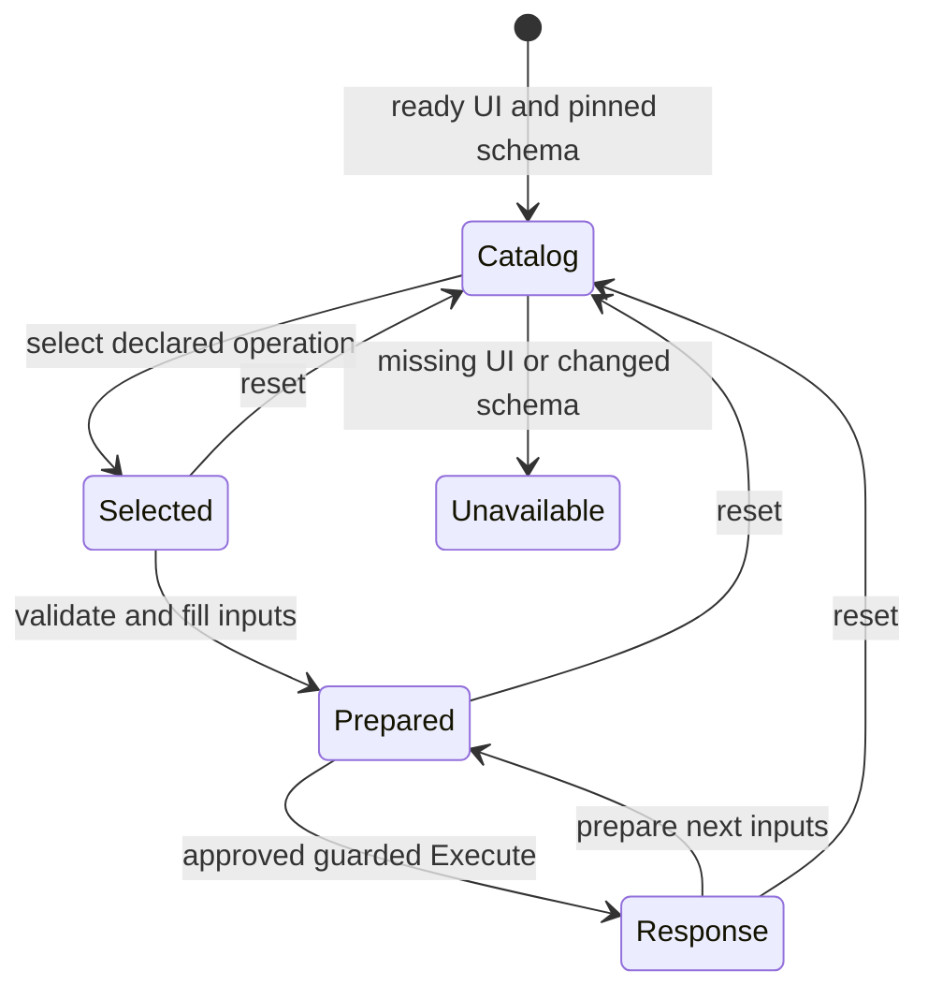

# Swagger API driving — source candidate

This reusable integration teaches Daedlo to operate a Swagger UI API explorer.
Roots is one customer acceptance fixture. The catalog, browser adapter and Rust
model contain no Roots route names, accounts, database assumptions or business
outcomes. The independent browser fixture uses different operations and schemas.
This source candidate is not in the published alpha.7 kit and is not a release.

## Compatibility

| Surface | Current boundary |
| --- | --- |
| OpenAPI documents | JSON 3.0.x, 3.1.x and 3.2.x; unknown versions rejected |
| Latest standard | OpenAPI 3.2.1; standard operations with the supported request/schema subset |
| Swagger UI | UI 5 DOM adapter; independent tests pin 5.34.1, plus real Roots embedded UI |
| HTTP operations | Classic verbs can be discovered; execution requires explicit project policy; non-GET/HEAD also needs explicit write permission |
| New 3.2 methods | QUERY and additionalOperations are discovered and marked unavailable for execution |
| Inputs | Scalar path/query/header values, JSON bodies, local schema references |
| Response evidence | Exact/range/default status, JSON content type and supported schema constraints; fresh matching request required |
| Servers | One non-templated same-origin server, inherited at root/path/operation level; base paths supported |
| Authentication | Owned/attached browser cookies and existing Swagger authorization; private inputs stay in the controlled browser and adapter memory |
| Unsupported | Swagger/OpenAPI 2.0, YAML loading, external/cyclic refs, multiple/templated/cross-origin servers, complex parameter serialization, multipart/files, OAuth orchestration, service-worker-controlled Swagger, regex assertions, streaming and full JSON Schema conformance |

OpenAPI 3.2.1 is the latest official specification as checked on 2026-11-09.
Swagger UI's 5.34.1 compatibility matrix lists OpenAPI 3.2.0 support; the
specification's patch-version compatibility rules apply to 3.2.1. This upstream
support is separate from the exact Daedlo test coverage in `docs/verification.md`.
Sources: [OpenAPI 3.2.1](https://spec.openapis.org/oas/v3.2.1.html),
[Swagger UI 5.34.1 matrix](https://github.com/swagger-api/swagger-ui/blob/v5.34.1/README.md#compatibility).

Discovery is not authorization or a claim of complete conformance. Unsupported
schema assertions and request encodings fail closed, with static capability
reasons. A successful HTTP/schema check says that the response matched the
transport contract. It does not establish the business outcome or persistence.

## Reuse with another project

From this source worktree, install the locked dependencies and build the generic
engine once (the Swagger UI fixture is a pinned development dependency; its transitive install analytics are disabled by the workspace configuration):

```sh
npm ci --ignore-scripts
cargo build --locked --manifest-path integrations/swagger/engine/Cargo.toml
```

Create a local profile outside Git. Paths to the engine resolve relative to the
profile. Supply the real docs and schema URLs and exact method/path operation
keys from that project's schema:

```json
{
  "docsUrl": "http://127.0.0.1:8080/docs/",
  "schemaUrl": "http://127.0.0.1:8080/openapi.json",
  "enginePath": "/absolute/path/to/swagger-engine",
  "allowOperations": ["GET /health"],
  "allowWrites": []
}
```

Launch with the existing CLI and viewer:

```sh
DAEDLO_SWAGGER_PROFILE=/absolute/path/to/profile.json \
  node packages/runtime/src/cli.mjs --project integrations/swagger/project.mjs
```

The CLI creates an isolated browser. The supplied application remains attached;
closing Daedlo preserves its API and database. The session owns its route guard,
engine and temporary metadata-only profile, and removes only these resources.
Failed cleanup remains retryable under the shared runtime's resource contract.
Do not put tokens, account passwords or business payloads in the static profile.

In the viewer, select an operation, prepare a request such as
`{"path":{"id":1},"query":{"limit":5},"headers":{},"body":{"value":"example"}}`,
and execute. Supply only fields declared by that operation. Parameters and bodies
are private: reports omit them, but Swagger itself displays them in the browser.
Do not share screenshots while credentials or private responses are visible.
A small canonical read recipe is generated only for allowed GET/HEAD operations
that validate with empty inputs. Recipes remain Rust-owned and use the normal
execution facade, freshness, stop/pause and completed-run reporting.

A custom project can import `createSwaggerSession` from `session.mjs`, perform
its own isolated authentication/fixture setup, and provide an optional trusted
`verifyEffect({operation,request,response})` callback. Return `{status:"saved"}`
only after independent evidence for the exact operation. An unavailable or
throwing verifier remains uncertain. Mutation HTTP status alone never produces
`saved`. Project-specific readback belongs in that project, not in the adapter.
The source runtime also exports the reusable helpers under `@daedlo/runtime/swagger`.

## Model and evidence

```rust
enum State {
    Unavailable,
    Catalog,
    Operation(OperationState), // Selected | Prepared | Response
}
```



The diagram describes implemented observations, not a promise that all application
states are reachable. Rust owns authorization, recipes and verification. Node
measures Swagger DOM/network facts, applies guarded primitives and checks the
supported transport schema. There is no duplicated application transition graph.

Prepared inputs are compared to the actual DOM and private browser authentication before dispatch. Authentication changes, including path-scoped cookies, invalidate preparation. Existing service-worker registrations or control are refused; use an isolated context with service workers blocked where available. Only one exact
prepared request can pass the page network guard; mismatched requests and
redirects are refused. Documented errors remain non-success outcomes. Unknown
responses, malformed/unsupported schemas and uncertain writes stay unknown or
uncertain. Safe reports contain operation metadata and status, never raw request
bodies, authorization, cookies, private evidence or hashes of private values.

## Validation

```sh
npm run test:swagger
```

The suite uses a pinned real Swagger UI with an independent local API fixture,
plus deterministic catalog and Rust model checks. It does not need Roots.

For actual Roots acceptance, use the separately supplied **disposable** native
API fixture and synthetic accounts. This script performs writes:

```sh
ROOTS_SWAGGER_DISPOSABLE=1 \
ROOTS_SWAGGER_ORIGIN=http://127.0.0.1:4301 \
ROOTS_SWAGGER_ACCOUNTS=/private/path/to/accounts.json \
SWAGGER_EVIDENCE_DIR=/absolute/path/to/fresh-evidence \
  node integrations/swagger/roots-acceptance.mjs
```

That test keeps customer-specific operations and persistence assertions outside
shared code. It identifies the actual binary/schema and distinguishes a supplied
working-tree API from a pinned-source or installed-package acceptance claim.

## Further compatibility work

Add a capability only with a specification example, independent fixture,
meaningful failing assertion, implementation and browser verification. Priorities
are additional authentication flows, selected external servers, richer input
serialization, and newer 3.2 execution/streaming features. Prefer explicit
capability reporting over a blanket “supports Swagger” claim. Installed packaging,
release checks and promotion remain separate work.
