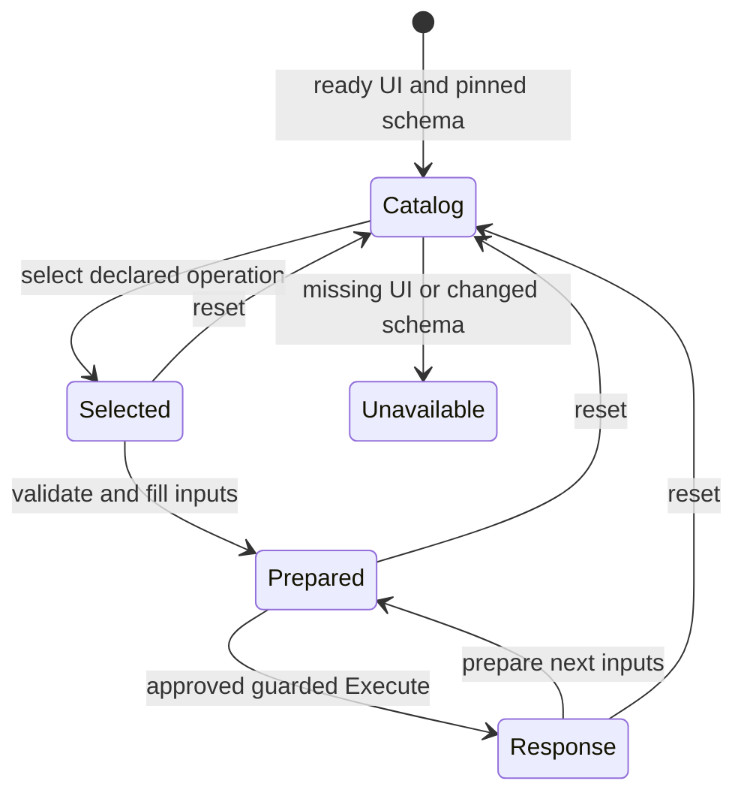

# Swagger API driving

This reusable integration teaches Daedlo to operate a Swagger UI API explorer.
Roots is one customer acceptance fixture. The catalog, browser adapter and Rust
model contain no Roots route names, accounts, database assumptions or business
outcomes. The independent browser fixture uses different operations and schemas.
The alpha.9 candidate ships this standalone integration in its portable tools.
Its release receipt records publication and exact installed verification; source
checks alone do not establish a released kit. Older kits do not gain these files
from a runtime-only update.

## Compatibility

| Surface           | Current boundary                                                                                                                                                                                                                                                         |
| ----------------- | ------------------------------------------------------------------------------------------------------------------------------------------------------------------------------------------------------------------------------------------------------------------------ |
| OpenAPI documents | JSON 3.0.x, 3.1.x and 3.2.x; unknown versions rejected                                                                                                                                                                                                                   |
| Latest standard   | OpenAPI 3.2.1; standard operations with the supported request/schema subset                                                                                                                                                                                              |
| Swagger UI        | UI 5 DOM adapter; independent tests pin 5.34.1, plus real Roots embedded UI                                                                                                                                                                                              |
| HTTP operations   | Classic verbs can be discovered; execution requires explicit project policy; non-GET/HEAD also needs explicit write permission                                                                                                                                           |
| New 3.2 methods   | QUERY and additionalOperations are discovered and marked unavailable for execution                                                                                                                                                                                       |
| Inputs            | Scalar path/query/header values, JSON bodies, local schema references                                                                                                                                                                                                    |
| Response evidence | Exact/range/default status, JSON content type and supported schema constraints; fresh matching request required                                                                                                                                                          |
| Servers           | One non-templated same-origin server, inherited at root/path/operation level; base paths supported                                                                                                                                                                       |
| Authentication    | Owned/attached browser cookies and existing Swagger authorization; private inputs stay in the controlled browser and adapter memory                                                                                                                                      |
| Unsupported       | Swagger/OpenAPI 2.0, YAML loading, external/cyclic refs, multiple/templated/cross-origin servers, complex parameter serialization, multipart/files, OAuth orchestration, service-worker-controlled Swagger, regex assertions, streaming and full JSON Schema conformance |

OpenAPI 3.2.1 is the latest official specification as checked on 2026-11-09.
Swagger UI's 5.34.1 compatibility matrix lists OpenAPI 3.2.0 support; the
specification's patch-version compatibility rules apply to 3.2.1. This upstream
support is separate from the exact Daedlo test coverage in `docs/verification.md`.
Sources: [OpenAPI 3.2.1](https://spec.openapis.org/oas/v3.2.1.html),
[Swagger UI 5.34.1 matrix](https://github.com/swagger-api/swagger-ui/blob/v5.34.1/README.md#compatibility).

Paths with literal or encoded dot segments, raw whitespace/control characters, or
URL delimiters are refused. The same check applies after all path parameters are
substituted, so template boundaries cannot change the authorized endpoint.
Ordinary embedded dots, Unicode and once-encoded scalar values remain supported.

Discovery is not authorization or a claim of complete conformance. Unsupported
schema assertions and request encodings fail closed, with static capability
reasons. A successful HTTP/schema check says that the response matched the
transport contract. It does not establish the business outcome or persistence.

Operation selection supports collapsed groups and Swagger UI 5.34.1's virtualized
catalog. When the exact method/path is not visible, the adapter uses Swagger's
layout navigation once to expand its group and reveal its row, then waits for a
single visible match within the configured timeout. Navigation and selection use
the shared guarded execution facade; neither submits an API request. Swagger
pages without the needed navigation capability can still select an already
visible operation. For a hidden operation on those pages, expand its group and
bring it into view before selecting it.

An active filter is preserved. A filtered-out, missing or ambiguous operation
produces a specific safe error with a next action; the adapter does not guess a
match, clear a filter, repeat Execute, or bypass Swagger with a direct request.
Expected adapter errors use static diagnostic codes and messages without raw
locators, request values or authentication details. A successful GET/HEAD says
“Documented API response verified; no write expected.” Successful mutation
responses retain the separate persistence limit until independent effect
evidence establishes what was saved.

## Start from the verified installed kit

Use the matching runtime, core crate and tools from one verified release. First
follow the kit's `START_HERE.md` and [release verification guide](../../docs/releases.md).
The commands below use alpha.9 filenames; replace the three absolute paths with
your verified tools installation, extracted bundle and a **new** private QA
folder. They do not change the application's normal dependencies.

```sh
tools_root=/absolute/tools/node_modules/@daedlo/release-tools
bundle_root=/absolute/verified/bundle
qa_root=/absolute/project/.daedlo-local/swagger-alpha9
mkdir "$qa_root"
npm install --prefix "$qa_root" --workspaces=false --ignore-scripts --no-audit --no-fund \
  "$bundle_root/daedlo-runtime-0.1.4-alpha.9.tgz"
node "$qa_root/node_modules/playwright/cli.js" install chromium
mkdir "$qa_root/vendor"
tar -xzf "$bundle_root/daedlo-engine-0.1.4-alpha.9.crate" -C "$qa_root/vendor"
node "$tools_root/integrations/swagger/build-model.mjs" \
  --crate "$qa_root/vendor/daedlo-engine-0.1.4-alpha.9" \
  --output "$qa_root/swagger-build"
```

The builder copies only the shipped model sources and lockfile into the fresh
output, checks the core's exact version, and uses `cargo build --locked` with a
separate target directory. It preserves the tools and extracted crate. Add
`--offline` only when the exact Cargo dependencies are already cached. Node 22+
and Rust 1.96+ are required; use the selected release's pinned toolchain and
matching Playwright Chromium. Chromium and Cargo dependency downloads are
separate from the Daedlo archives.

Create `$qa_root/profile.json` with the real Swagger docs/schema URLs and exact
method/path operation keys from that application's schema. This sample assumes
an existing `GET /health` operation. `runtimeRoot` and `enginePath` resolve relative
to the profile file; installed tools require `runtimeRoot` and reject a different
runtime version. The schema must be available without a separately supplied
schema-fetch credential. Browser authentication remains project-owned.

```json
{
  "docsUrl": "http://127.0.0.1:8080/docs/",
  "schemaUrl": "http://127.0.0.1:8080/openapi.json",
  "runtimeRoot": "./node_modules/@daedlo/runtime",
  "enginePath": "./swagger-build/target/debug/swagger-engine",
  "allowOperations": ["GET /health"],
  "allowWrites": []
}
```

Launch the exact installed CLI and shipped project:

```sh
DAEDLO_SWAGGER_PROFILE="$qa_root/profile.json" \
  node "$qa_root/node_modules/@daedlo/runtime/src/cli.mjs" \
  --project "$tools_root/integrations/swagger/project.mjs"
```

Use `--headed` when signing in manually before preparing requests. Open the
printed loopback viewer URL; startup does not execute an API operation. This
standalone route currently uses a POSIX launcher. Windows and native managed
Swagger onboarding/upgrades are unsupported; existing managed application flows
keep their separate contract. Do not register this standalone profile as a
managed integration without a reviewed managed launcher and acceptance.

For development from a reviewed source checkout, `npm ci --ignore-scripts` and
`cargo build --locked --manifest-path integrations/swagger/engine/Cargo.toml`
build the source candidate. A source profile may omit `runtimeRoot`; this only
works in the Daedlo workspace layout. Launch with
`node packages/runtime/src/cli.mjs --project integrations/swagger/project.mjs`
and the same `DAEDLO_SWAGGER_PROFILE` environment variable. Installed helpers never
fall back to that checkout route.

The CLI creates an isolated browser. The supplied application remains attached;
closing Daedlo preserves its API and database. The session owns its route guard,
engine and temporary metadata-only profile, and removes only these resources.
Failed cleanup remains retryable under the shared runtime's resource contract.
Do not put tokens, account passwords or business payloads in the static profile.

In the viewer, select an operation, prepare a request such as
`{"path":{"id":1},"query":{"limit":5},"headers":{},"body":{"value":"example"}}`,
and execute. Supply only fields declared by that operation. Parameters and bodies
are private: reports omit them, but Swagger itself displays them in the browser.
Do not share screenshots while credentials or private responses are visible.
A small canonical read recipe is generated only for allowed GET/HEAD operations
that validate with empty inputs. Recipes remain Rust-owned and use the normal
execution facade, freshness, stop/pause and completed-run reporting.

A custom project can import `createSwaggerSession` from `session.mjs`, perform
its own isolated authentication/fixture setup, and provide an optional trusted
`verifyEffect({operation,request,response})` callback. Return `{status:"saved"}`
only after independent evidence for the exact operation. An unavailable or
throwing verifier remains uncertain. Mutation HTTP status alone never produces
`saved`. Project-specific readback belongs in that project, not in the adapter.
Pass the exact `runtimeRoot` to a custom session helper too. The selected runtime
exports its lower-level catalog and adapter under `@daedlo/runtime/swagger`; the
helper resolves both public package exports from that same package directory.

## Model and evidence

```rust
enum State {
    Unavailable,
    Catalog,
    Operation(OperationState), // Selected | Prepared | Response
}
```



The diagram describes implemented observations, not a promise that all application
states are reachable. Rust owns authorization, recipes and verification. Node
measures Swagger DOM/network facts, applies guarded primitives and checks the
supported transport schema. There is no duplicated application transition graph.

Prepared inputs are compared to the actual DOM and private browser authentication before dispatch. Authentication changes, including path-scoped cookies, invalidate preparation. Existing service-worker registrations or control are refused; use an isolated context with service workers blocked where available. Only one exact
prepared request can pass the page network guard; mismatched requests and
redirects are refused. Documented errors remain non-success outcomes. Unknown
responses, malformed/unsupported schemas and uncertain writes stay unknown or
uncertain. Safe reports contain operation metadata and status, never raw request
bodies, authorization, cookies, private evidence or hashes of private values.

## Validation

Source checks (require the repository):

```sh
npm run test:swagger
```

The suite uses a pinned real Swagger UI with an independent local API fixture,
plus deterministic catalog and Rust model checks. It does not need Roots. The
release gate `tests/swagger-installed-acceptance.mjs` separately installs verified
archives outside a checkout, rebuilds the shipped model against the exact crate,
launches the installed CLI/project, and checks reads, write policy, freshness,
authentication, persistence evidence and cleanup. Its receipt binds the model
binary and package inventories. The Swagger UI fixture remains a development
dependency; customer applications supply their own Swagger UI.

For actual Roots acceptance, use the separately supplied **disposable** native
API fixture and synthetic accounts. This script performs writes:

```sh
ROOTS_SWAGGER_DISPOSABLE=1 \
ROOTS_SWAGGER_ORIGIN=http://127.0.0.1:4301 \
ROOTS_SWAGGER_ACCOUNTS=/private/path/to/accounts.json \
SWAGGER_EVIDENCE_DIR=/absolute/path/to/fresh-evidence \
  node integrations/swagger/roots-acceptance.mjs
```

That test keeps customer-specific operations and persistence assertions outside
shared code. It identifies the actual binary/schema and distinguishes a supplied
working-tree API from a pinned-source or installed-package acceptance claim.

## Further compatibility work

Add a capability only with a specification example, independent fixture,
meaningful failing assertion, implementation and browser verification. Priorities
are additional authentication flows, selected external servers, richer input
serialization, and newer 3.2 execution/streaming features. Prefer explicit
capability reporting over a blanket “supports Swagger” claim. Package verification,
customer acceptance and promotion remain separate evidence.
